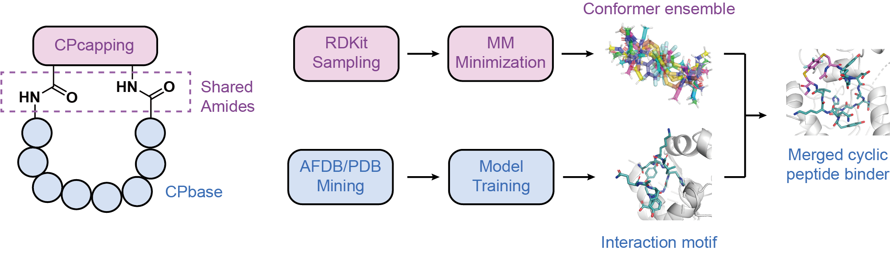

# PepAny: Generating cyclic peptide binders with any cyclization topologies

PepAny is a generation pipeline for designing peptide binders, with support for linear peptides, capped or cyclized peptides, small-molecule-like ligand generation, and antibody CDR generation. The cyclic peptide workflow is built around terminal-geometry conditioned generation followed by structure-level filtering, so users can screen multiple cyclization chemistries against the same protein targets.

This repository is an example application of CPSea-2.



## Main Features

- Generate peptide binders from receptor structures.
- Support multiple template classes, including `LinearPeptide`, `CappedLinearPeptide`, `DeNovoCappedLinearPeptide`, `Molecule`, and `Antibody`.
- Run cyclic peptide generation with user-defined terminal cap SDF libraries.
- Filter generated candidates by terminal RMSD, receptor clash, and ligand amide bond geometry.
- Resume incomplete generation runs from previous output directories.
- Track generated candidates, accepted structures, per-target success rates, and remaining sampling budgets.
- Split large generation jobs across multiple GPUs or nodes.

## Installation

PepAny is tested with Python 3.9 and PyTorch. Choose the conda environment file that matches your CUDA version:

```bash
conda env create -f env_cuda121.yaml
conda activate PepAny
```

Other provided environment files:

```bash
env_cuda117.yaml
env_cuda128.yaml
```

If you install dependencies manually, make sure the environment includes PyTorch, PyG `pytorch-scatter`, RDKit, OpenBabel, OpenMM, PDBFixer, Biopython, ANARCI, MMseqs2, and the Python packages listed in the environment files.

## Checkpoints

Place the trained checkpoint under `checkpoints/`, for example:

```text
checkpoints/pepany_v1.ckpt
```

Then pass it to generation with `--ckpt`.

## Quick Start

Run cyclic peptide generation with the demo config:

```bash
python -m api.generate \
  --config api/demo/config.yaml \
  --ckpt checkpoints/pepany_v1.ckpt \
  --save_dir outputs/demo \
  --gpu 0
```

Run nanobody or antibody CDR generation:

```bash
python -m api.generate \
  --config api/demo/nanobody_config.yaml \
  --ckpt checkpoints/pepany_v1.ckpt \
  --save_dir outputs/nanobody_demo \
  --gpu 0
```

Use `--gpu -1` to run on CPU, although generation will be much slower.

## Input Config

Generation is controlled by a YAML file. A minimal dataset block looks like:

```yaml
dataset:
  pdb_dir: ./api/CPtest
  pdb_pattern: "*.pdb"
  recursive: false
  tgt_chains: R
  lig_chains: L
  ligand_size_mode: ca

seed: 12
batch_size: 128
```

For cyclic peptide generation, each template defines a cyclization topology and an SDF library of terminal cap conformers:

```yaml
templates:
  - name: ThioEther-C
    class: DeNovoCappedLinearPeptide
    size_from_ligand: true
    term_rel_pos_sdf:
      path: ./api/CPcap/ThioEther-C/accepted_energy_filtered_sdf
      pattern: "*.sdf"
      sampling_mode: with_replacement
      index_base: 0
      n_term_atom_indices: [9, 10, 13, 11, 12]
      c_term_atom_indices: [0, 1, 29, 2, 3]
    pipeline:
      enabled: true
      goal_num: 10
      max_sampling_number: 100000
      rmsd_cutoff: 1.0
      clash_threshold: 0.8
      output_dir: accepted
```

Important fields:

- `goal_num`: number of accepted structures required for each target.
- `max_sampling_number`: maximum number of candidate generations before stopping. Use `null` for no fixed budget.
- `sampling_mode: with_replacement`: terminal conformers may be reused.
- `sampling_mode: without_replacement`: terminal conformers are shuffled and consumed without reuse.
- `rmsd_cutoff`: terminal cap alignment cutoff used by the accepted pipeline.
- `clash_threshold`: receptor clash distance threshold.
- `seed`: random seed. It can also be overridden by `--seed`.

## Output Layout

For each template, PepAny writes one run directory:

```text
outputs/demo/
  ThioEther-C/
    candidates/
      generation_stats.json
      results.jsonl
      <target_id>/
        pocket.pdb
        10.pdb
        10.sdf
    accepted/
      metadata.csv
      accepted_1.cif
      accepted_2.cif
```

`candidates/` stores raw generated candidates and generation statistics. `accepted/` stores structures that pass the pipeline filters.

The `generation_stats.json` file records total and per-target statistics:

```json
{
  "batches_generated": 10,
  "generated_candidates": 640,
  "generated_candidates_this_run": 640,
  "accepted_total": 25,
  "accept_rate": 0.0391,
  "per_target": {
    "target_id": {
      "generated_candidates": 100,
      "accepted": 5,
      "success_rate": 0.05
    }
  }
}
```

## Resume Generation

Resume mode reads previous accepted structures and `candidates/generation_stats.json`, then computes how many structures remain for each target:

```yaml
resume_generation:
  enabled: true
  previous_dir: outputs/demo
  remaining_sampling_budget: null
```

`previous_dir` can be the same directory as `--save_dir`, as long as it contains the previous template folders with `accepted/` and `candidates/`.

If `remaining_sampling_budget` is set, it overrides `max_sampling_number` for the resumed run:

```yaml
resume_generation:
  enabled: true
  previous_dir: outputs/demo
  remaining_sampling_budget: 20000
```

For example, if the previous run generated 100000 candidates, `remaining_sampling_budget: 20000` makes the effective stopping point 120000 total candidates. This is useful when you want to extend a hard target or cyclization by a controlled number of additional attempts.

## Sanitize Existing Accepted Structures

The accepted pipeline checks ligand amide C-N distances during generation. You can also sanitize a previous accepted directory before resuming:

```yaml
resume_generation:
  enabled: true
  previous_dir: outputs/demo

sanitize_generation:
  enabled: true
  max_c_n_distance: 1.8
```

Sanitization scans only accepted `.cif` files, removes structures with implausible ligand amide distances, renames the remaining accepted structures to keep continuous indices, and rewrites `metadata.csv`. It does not modify `candidates/`.

## Parallel Generation

Large jobs can be split across GPUs or nodes with `task_split`:

```yaml
task_split:
  enabled: true
  total: 3
  index: 0
```

Equivalent command-line overrides are also available:

```bash
python -m api.generate \
  --config api/demo/config.yaml \
  --ckpt checkpoints/pepany_v1.ckpt \
  --save_dir outputs/demo \
  --gpu 0 \
  --num_shards 3 \
  --shard_id 0
```

Launch one process for each shard, with shard IDs from `0` to `total - 1`. For independent jobs, use different seeds to reduce duplicate sampling:

```bash
python -m api.generate ... --seed 13
python -m api.generate ... --seed 113
python -m api.generate ... --seed 213
```

## CPU Parallelism

Candidate post-processing can be parallelized on CPU:

```yaml
generation_postprocess:
  num_workers: 4
  backend: process
  start_method: spawn
  torch_num_threads: 1
```

Generation batch prefetch is also configurable:

```yaml
generation_prefetch:
  num_workers: 0
  prefetch_batches: 2
  backend: thread
  allow_process_backend: false
  start_method: spawn
  torch_num_threads: 1
```

For many GPU workloads, a larger `batch_size` is more beneficial than process-based prefetching. If `max_sampling_number` is set, prefetching is disabled to preserve the exact attempt limit.

## Useful Commands

Resume a previous run and add 20000 more candidate attempts:

```bash
python -m api.generate \
  --config api/demo/config.yaml \
  --ckpt checkpoints/pepany_v1.ckpt \
  --save_dir outputs/demo \
  --gpu 0
```

The YAML should include:

```yaml
resume_generation:
  enabled: true
  previous_dir: outputs/demo
  remaining_sampling_budget: 20000
```

Run one shard of a multi-GPU job:

```bash
python -m api.generate \
  --config api/demo/config.yaml \
  --ckpt checkpoints/pepany_v1.ckpt \
  --save_dir outputs/demo \
  --gpu 1 \
  --num_shards 3 \
  --shard_id 1
```

## Notes

- The cyclic peptide demo config references terminal cap SDF libraries under `api/CPcap/`. Prepare these libraries before running the cyclic generation pipeline.
- Accepted structures are saved as `.cif`; raw candidates are saved as `.pdb` and `.sdf`.
- During resume, accepted structure indices continue from the previous accepted directory to avoid overwriting files.
- During resume, candidate indices also continue from previous candidate slots.
- When comparing cyclization topologies, report both accepted counts and generated candidate counts whenever possible, because hard targets may receive more attempts than easy targets near the end of a run.

## License

This project is released under the MIT License. See [LICENSE](LICENSE) for details.
